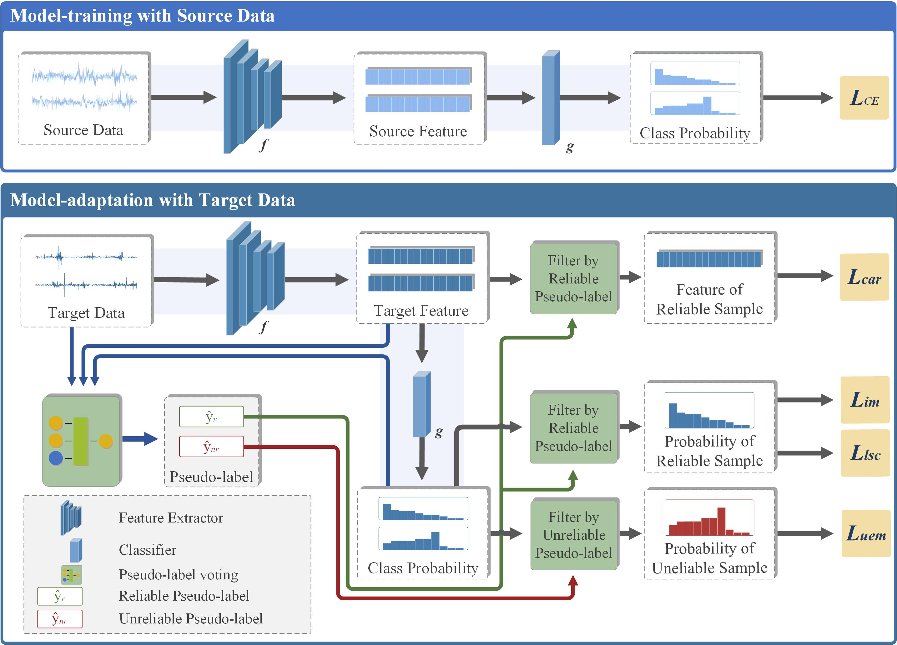
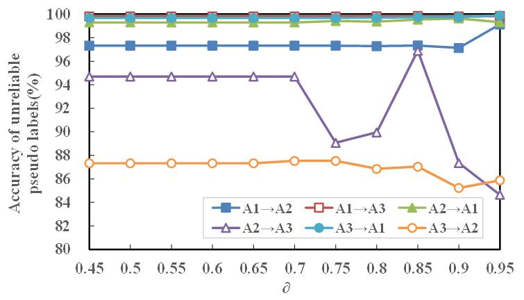
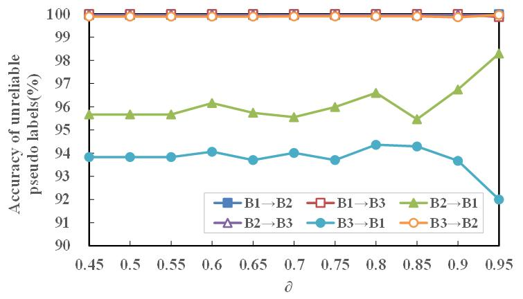
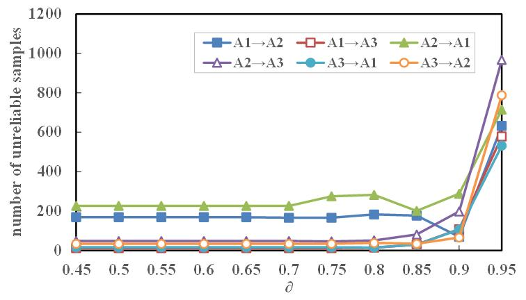
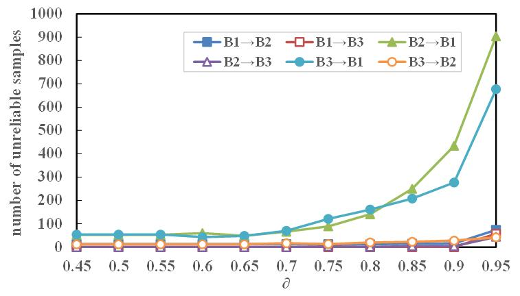
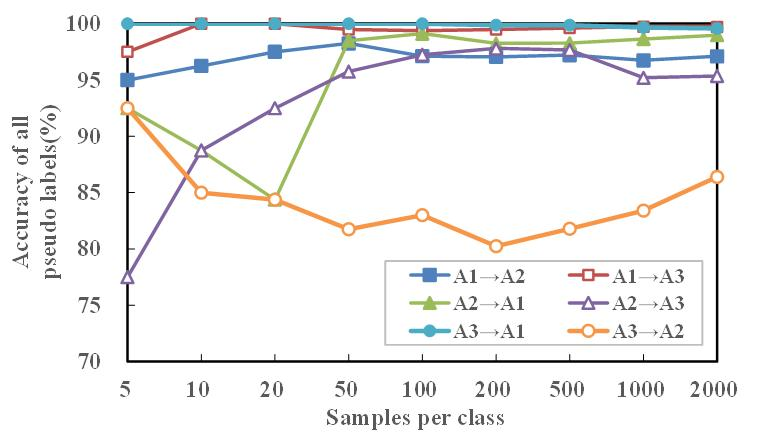
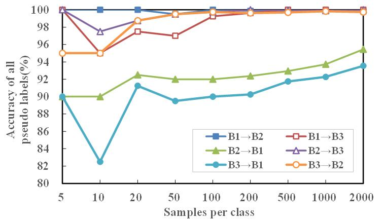
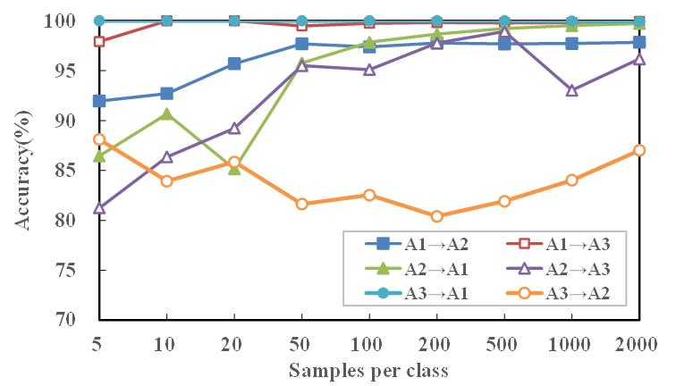
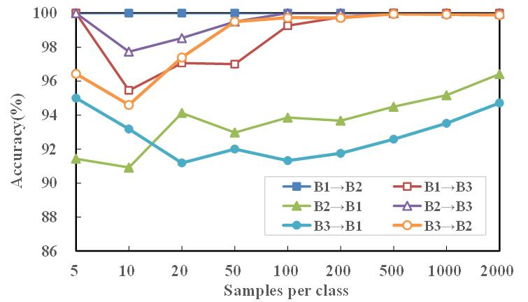

# Official implementation for **SDALR**

## Both Reliable and Unreliable Predictions Matter: Domain Adaptation for Bearing Fault Diagnosis without Source Data

[中文使用指南](docs/使用指南.md) — repository layout, dataset manifests, single-task commands, and implementation notes.

The original README did not provide a valid paper URL. The paper title is retained above without a placeholder link.

### Framework:  



### Prerequisites:
- python == 3.11.10
- pytorch ==2.4.1
- Third-party packages imported by the training pipeline: torchvision, numpy, scipy, scikit-learn, Pillow, openpyxl, matplotlib, seaborn.
- `sklearn` and `PIL` are the import names for `scikit-learn` and `Pillow`. `argparse` and `collections` are part of Python's standard library.
- The current training code calls `.cuda()` directly and requires a CUDA-capable PyTorch environment. No CPU fallback is implemented.
- The versions above are the upstream reference versions. This repository does not include a dependency lock file; these documentation edits do not verify a training environment.

### Dataset:

-  Please manually download the datasets [PU](https://pan.baidu.com/s/1d505GjqsmHWlwFG5hb5c3Q?pwd=5m1l), [JNU](https://pan.baidu.com/s/1d505GjqsmHWlwFG5hb5c3Q?pwd=5m1l).  
-  Put the downloaded datasets into `./DATA/` with the following structure:

```
DATA
├── PU_1d_8c_2048
│ ├── data
│ │ ├── K001
│ │ │ ├── sample.txt
│ │ │ └── ...
│ │ ├── K002
│ │ │ ├── sample.txt
│ │ │ └── ...
│ │ └── ...
│ ├── N15_M01_F10_label.txt
│ ├── N15_M07_F10_label.txt
│ └── N15_M07_F04_label.txt
│
└── JNU_1d_2048_2000
  ├── data
  │ ├── NO
  │ │ ├── sample.txt
  │ │ └── ...
  │ ├── OR
  │ │ ├── sample.txt
  │ │ └── ...
  │ └── ...
  ├── 600_label.txt
  ├── 800_label.txt
  └── 1000_label.txt
```

- `data/` contains the raw time-series samples organized by fault categories.  
- The scripts read one `<domain>_label.txt` manifest per domain. Each nonempty line contains a sample path and a zero-based integer class label, separated by whitespace.
- Paths in the manifests are opened as written. Relative paths resolve from the working directory, not from the manifest's directory. Run commands from the repository root and check that these paths match your local data layout.
- The sample folders above are illustrative. Dataset files and pretrained weights are not included in the repository.

### Experimental Results

#### Diagnosis Accuracy
We evaluate SDALR on the PU and JNU datasets under source-free settings.  
The results show that SDALR consistently outperforms UDA and SFDA baselines.  

The figures below are supplied by the upstream repository. A valid paper link for detailed per-task results has not been supplied.

#### Reliability Threshold ($\partial$):
  With $\beta=0.6$, we varied $\partial$ from 0.45 to 0.95.  
  - Too high ($\partial > 0.9$): pseudo-label accuracy fluctuates, unreliable samples increase.  
  - Moderate ($0.4 \leq \partial \leq 0.7$): stable pseudo-label accuracy and diagnostic performance.  
  - Conclusion: $\partial$ governs the trade-off, while voting ensures robustness.  

<table>
  <tr>
    <td></td>
    <td></td>
  </tr>
  <tr>
    <td></td>
    <td></td>
  </tr>
</table>

#### Sample Size Analysis:
  With $\beta=0.6$, $\partial=0.6$, we varied the number of target samples.  
  - (a) Accuracy of all pseudo-labels (%)  
  - (b) Fault diagnosis accuracy (%)  
  - Results confirm the scalability and robustness of the method.

<table>
  <tr>
    <td></td>
    <td></td>
  </tr>
  <tr>
    <td></td>
    <td></td>
  </tr>
</table>

### Training

Run all commands from the repository root (the directory containing this README). There is no `object/` directory in this checkout. Prepare the datasets and CUDA environment before starting training.

#### Single-task examples

These commands select source domain `0` and target domain `1`; other training parameters retain their Python defaults. Pretraining must complete before adaptation. The Python commands can be used in PowerShell or Bash.

PU:

```bash
python src_pretrain_RES_PU.py --s 0 --t 1
python tar_adaptation_RES_PU.py --s 0 --t 1
```

JNU:

```bash
python src_pretrain_RES_JNU.py --s 0 --t 1
python tar_adaptation_RES_JNU.py --s 0 --t 1
```

#### Batch experiments

First pretrain all source domains for the selected dataset, then run its adaptation script:

```bash
python src_pretrain_RES_PU.py
bash choose_s_t_PU.sh
```

```bash
python src_pretrain_RES_JNU.py
bash choose_s_t_JNU.sh
```

The `.sh` files require Bash 4+ and utilities such as `awk` and `seq`. On Windows, use a suitable Git Bash or WSL environment with access to the prepared Python/CUDA environment. PowerShell does not interpret Bash scripts directly.

The batch scripts define their parameter grids internally. In particular, `choose_s_t_JNU.sh` sweeps `--num` over `50 20 10 5`, while the JNU Python script defaults to all samples. See the [Chinese guide](docs/使用指南.md) for domain indices and parameter semantics.

#### Ablation studies

After preparing source checkpoints, the supplied ablation scripts can be run from Bash:

```bash
bash ablation_PU.sh
bash ablation_JNU.sh
```

These scripts launch multiple runs. Inspect their parameter combinations and logs when comparing results; their final completion message alone does not establish that every run succeeded.

### Contact

- [bd_lab@163.com](mailto:bd_lab@163.com)
